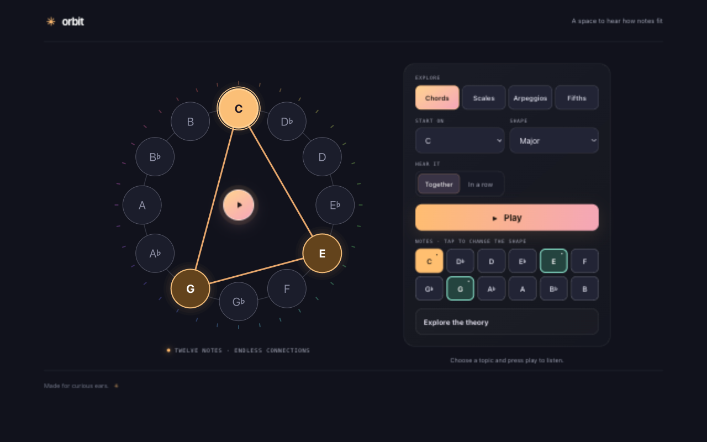

# Orbit — Music Theory Explorer

Explore how notes connect with an interactive circle of music theory.

[Open Orbit on GitHub Pages](https://qwertypants.github.io/orbit-notes/)



## What you can do

- Explore chords, scales, arpeggios, and the circle of fifths.
- Change the root note and pattern, or tap notes to make a custom shape.
- Hear notes together or in sequence.
- See how selected notes relate to the root.
- Install the app and use it offline, including piano and guitar playback.

## Run locally

Requires Node.js and npm.

```sh
npm install
npm run dev
```

To create a production build, run `npm run build`. To run the test suite, run `npm test`.

The first online visit downloads a complete offline release, including code that loads on demand and all bundled audio samples. Keep the app open until that initial service-worker installation finishes. Subsequent launches use the saved release immediately without waiting for the network.

Orbit checks for updates in the background on launch, when you return to the tab, and when the browser comes back online. A new release must download and pass file checks completely before it can replace the working copy. Close all Orbit tabs and installed-app windows, then reopen to use a downloaded update. Updates never force a reload during playback.

Offline use requires a production build served over HTTPS or localhost. Clearing site data or browser storage eviction removes the saved release and requires another online visit. Development mode does not install an offline cache.

To verify offline loading and safe updates in Chromium, run `npx playwright install chromium`, `npm run build`, and `npm run test:offline`. For the GitHub Pages path, run `npm run build -- --mode pages` followed by `npm run test:offline -- /orbit-notes/`.
