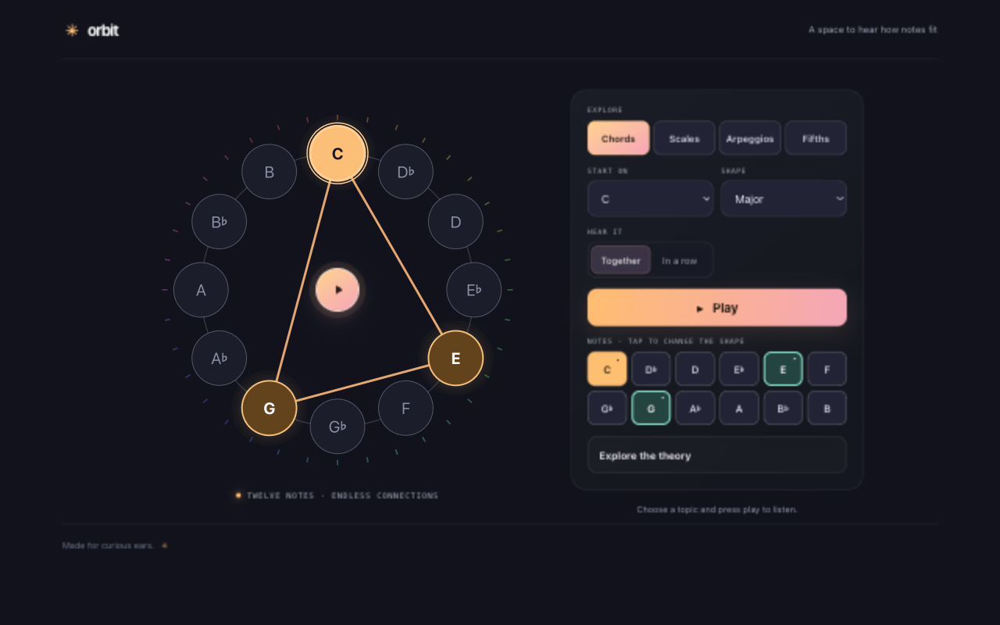

# Orbit — Music Theory Explorer

Explore how notes connect with an interactive circle of music theory.

[Open Orbit on GitHub Pages](https://qwertypants.github.io/orbit-notes/)



## What you can do

- Explore chords, scales, arpeggios, and the circle of fifths.
- Change the root note and pattern, or tap notes to make a custom shape.
- Hear notes together or in sequence.
- See how selected notes relate to the root.
- Install the app and revisit its cached interface offline.

## Run locally

Requires Node.js and npm.

```sh
npm install
npm run dev
```

To create a production build, run `npm run build`. To run the test suite, run `npm test`.

The service worker caches the app shell and loaded same-origin assets after your first visit. Audio files that have not been loaded before going offline may be unavailable.
